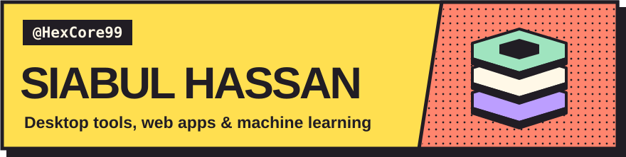

[**Portfolio ↗**](https://siabulhassan.xyz/)　·　[LinkedIn](https://www.linkedin.com/in/siabul-hassan/)　·　[Email](mailto:siabulhassan@gmail.com)

## Selected work

| Project | What it does |
| :--- | :--- |
| [**Taskora ↗**](https://github.com/HexCore99/Taskora) | A desktop Kanban board that keeps your tasks on your machine and works offline.   `Tauri` `React` `SQLite` |
| [**WhoLocks ↗**](https://github.com/HexCore99/wholocks) | Shows which Windows process is holding a file or folder open, from Explorer or the command line.   `Rust` `Windows API` |
| [**QuickJudge ↗**](https://github.com/HexCore99/QuickJudge) | A programming contest platform where you can submit code, see the verdict, and follow the leaderboard.   `React` `Express` `MySQL` |
| [**Neural Movie Recommender ↗**](https://github.com/HexCore99/neural-movie-recommender) | Recommends films using neural collaborative filtering.   `TensorFlow` `Flask` `Next.js` |

## Study & teaching

I study Computer Science and Engineering at **United International University**, where I help teach Data Structures and Algorithms I and II.

[Browse my C and C++ programming solutions ↗](https://github.com/HexCore99/hexcore99.github.io)
