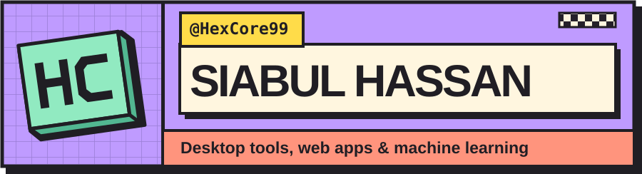
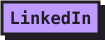
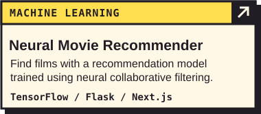
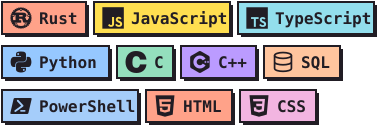

  
  
  

## Selected work

  
  
  
  

## Languages

## Study & teaching

I study Computer Science and Engineering at **United International University**, where I help teach Data Structures and Algorithms I and II.

[Browse my C and C++ programming solutions ↗](https://github.com/HexCore99/hexcore99.github.io)
