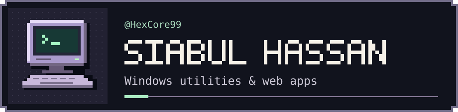
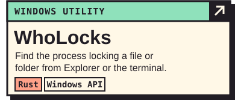
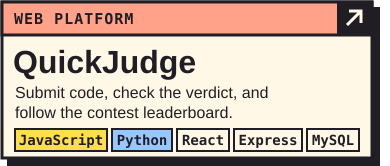

I build Windows utilities in Rust and apps for the web. WhoLocks started with a question I kept running into: *which process is holding this file open?*

  <a href="https://siabulhassan.xyz/"><b>Portfolio ↗</b></a>
  &nbsp; · &nbsp;
  <a href="https://www.linkedin.com/in/siabul-hassan/">LinkedIn</a>
  &nbsp; · &nbsp;
  <a href="mailto:siabulhassan@gmail.com">Email</a>

## Selected projects

  
  
  

## At the university

<table>
  <tr>
    <td align="center"></td>
    <td><strong>United International University</strong> 
    I study Computer Science and Engineering and help teach Data Structures and Algorithms I and II. 
    <a href="https://github.com/HexCore99/hexcore99.github.io">Browse my C and C++ programming solutions ↗</a></td>
  </tr>
</table>
