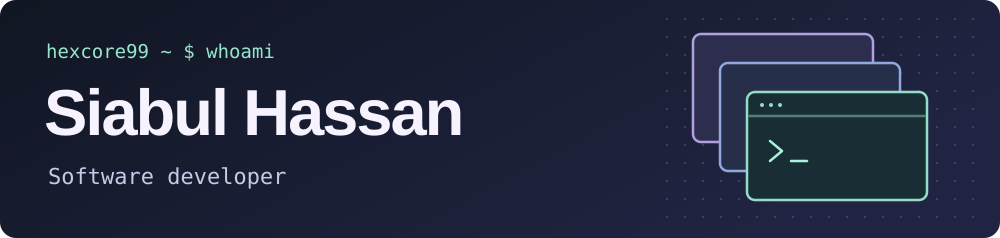

  <a href="https://siabulhassan.xyz/"><b>Portfolio ↗</b></a>
  &nbsp; · &nbsp;
  <a href="https://www.linkedin.com/in/siabul-hassan/">LinkedIn</a>
  &nbsp; · &nbsp;
  <a href="mailto:siabulhassan@gmail.com">Email</a>

I build Windows utilities in Rust and apps for the web. WhoLocks started with a question I kept running into: *which process is holding this file open?*

## Project inventory

**[WhoLocks](https://github.com/HexCore99/wholocks)** · `Rust` `Windows API` 
Find out which process is locking a file or folder from File Explorer or the command line.

**[Taskora](https://github.com/HexCore99/Taskora)** · `Tauri` `React` `Rust` `SQLite` 
Organize tasks on an offline Kanban board. Your data stays on your machine.

**[QuickJudge](https://github.com/HexCore99/QuickJudge)** · `React` `Express` `MySQL` 
Submit a solution, check the verdict, and follow the contest leaderboard.

## At the university

I study Computer Science and Engineering at United International University and help teach Data Structures and Algorithms I and II. My [C and C++ programming solutions](https://github.com/HexCore99/hexcore99.github.io) are on GitHub.
